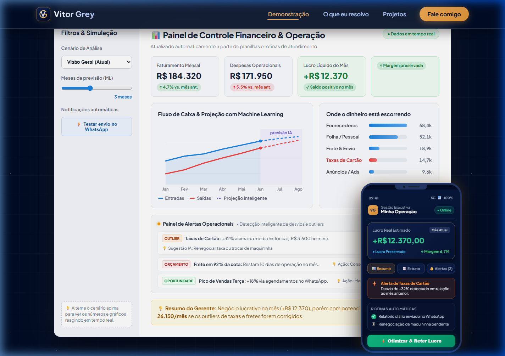

# Portfólio de Vitor Grey 💻

  <a href="https://staging.d1eaxlwkui9mlf.amplifyapp.com/" target="_blank">🔗 Visualizar projeto online</a>

---

## 📝 Descrição

Este é o site de portfólio pessoal de **Vitor Grey**, elaborado em HTML, CSS e um pouco de JavaScript. A ideia é apresentar meu perfil profissional, conhecimentos, trabalhos e formas de contato de maneira simples, leve e responsiva.

## 🚀 Funcionalidades principais

- Layout responsivo (desktop e mobile)
- Seções informativas: "Sobre mim", "Conhecimentos", "Projetos" e "Fale comigo";
- Navegação fixa com links de âncora;
- Rodapé com mensagem e contatos sociais;
- Animações sutis e uso de fontes customizadas;
- Perfil e imagem profissional em destaque.

## 🛠 Tecnologias utilizadas

- **HTML5** para estruturação;
- **CSS3** para estilo, incluindo media queries para responsividade;
- **JavaScript** básico para interatividade (menu mobile, animações, etc.).

> Todo o código é frontend e está contido nesta pasta, sem frameworks.

---

#### 💬 Comentario dos Devs

<table>
  <tr>
    <td>
      
    </td>
    <td>
      Escrito por <a href="https://github.com/vitugrey">Vitor Grey.</a>
    </td>
    <td>
      <i>Tomei vergonha e codei um frontend para apresentar meus projetos</i>
    </td>
  </tr>
  <tr>
    <td>
      
    </td>
    <td>
      Feito por <a href="#">Kallia 2.0.</a>
    </td>
    <td>
      <i>Ai ai.</i>
    </td>
  </tr>
</table>